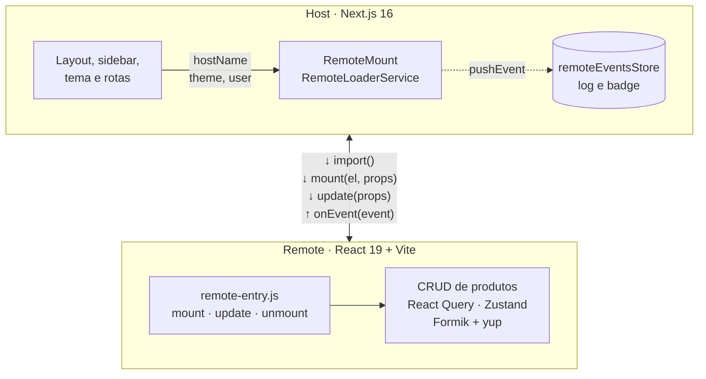

# Microfrontend Host (Next.js)

Shell em **Next.js 16 (App Router)** que carrega microfrontends React em runtime.
O remote de exemplo (CRUD de produtos) fica em [`project-react-microfrontend-remote`](https://github.com/DiguinhoLNS/project-react-microfrontend-remote).



## Stack

- Next.js 16 (Turbopack, Cache Components) + React 19 + TypeScript
- Tailwind CSS v4 (`@tailwindcss/turbopack`) + [shadcn/ui](https://ui.shadcn.com) (preset `radix-nova`, ícones Lucide)
- Zustand (eventos recebidos dos remotes)
- Tema claro/escuro com [`@wrksz/themes`](https://themes.wrksz.dev)
- Yarn 4 (versionado em `.yarn/releases`), ESLint, Husky + Commitlint

## Rodando local

O host consome o build do remote (`yarn serve`, porta 4173). Em um terminal, no repo do remote:

```bash
yarn serve
```

Em outro, neste repo:

```bash
yarn install
yarn dev
```

Abra http://localhost:3000/produtos. Sem `.env.local`, o host busca o remote em `http://localhost:4173/remote-entry.js`.
Se o remote não estiver no ar, a página mostra "Microfrontend indisponível" com o botão "Tentar novamente".

Para desenvolver só o remote com HMR, use `yarn dev` no repo dele (modo standalone, porta 5173).

## Scripts

| Comando | O que faz |
| --- | --- |
| `yarn dev` | Servidor de desenvolvimento |
| `yarn build` | Build de produção |
| `yarn start` | Sobe o build de produção |
| `yarn lint` | ESLint |
| `yarn typecheck` | Gera os tipos de rota e roda o `tsc` |

## Estrutura

Rotas finas em `app/` (só definem `metadata` e renderizam a página do módulo) e a lógica em `modules/`.

```
src/
├── app/
│   ├── layout.tsx           # html, fontes, ThemeProvider e providers globais
│   ├── not-found.tsx        # 404 -> modules/error
│   └── (app)/               # rotas com o layout de Sidebar + Header
│       ├── page.tsx         # /          -> modules/home
│       └── produtos/        # /produtos  -> modules/products
├── components/
│   ├── app/                 # providers (ClientProvider)
│   ├── common/              # componentes reutilizáveis (ThemeToggle)
│   ├── layout/App           # SidebarProvider + Sidebar + Header + main
│   ├── page/                # partes de página (Sidebar, Header, PageHeader)
│   └── ui/                  # componentes do shadcn (gerados pela CLI)
├── env/                     # variáveis de ambiente tipadas
├── hooks/                   # useMobile
├── lib/                     # `cn` do shadcn
├── modules/                 # domínios (pages, components, constants, interfaces...)
│   ├── error/
│   ├── home/
│   ├── microfrontends/      # infraestrutura genérica de MFE
│   │   ├── components/      # RemoteMount: monta qualquer remote pelo contrato
│   │   ├── constants/       # contract.ts (versão), remotes.ts (registro), host.ts (nome e usuário demo)
│   │   ├── interfaces/      # IRemoteContract (espelho do contrato do remote), IRemoteConfig...
│   │   ├── services/        # remoteLoaderService.ts
│   │   ├── store/           # remoteEventsStore.ts (eventos recebidos dos remotes)
│   │   └── utils/           # formatRemoteEvent
│   └── products/            # página que hospeda o remote de produtos (+ painel de status e eventos)
└── utils/
```

O layout usa o `Sidebar` do shadcn: recolhível em modo ícone no desktop (`Ctrl+B`) e em `Sheet` no mobile.
Para adicionar um item no menu, edite [`components/page/Sidebar/constants/links.ts`](src/components/page/Sidebar/constants/links.ts);
o breadcrumb do Header usa a mesma lista.

## Variáveis de ambiente

Copie o `.env.example` para `.env.local` se precisar mudar algum valor. O `.env*` não é versionado.

| Variável | Descrição | Padrão |
| --- | --- | --- |
| `NEXT_PUBLIC_REMOTE_PRODUCTS_URL` | URL absoluta do `remote-entry.js` do remote de produtos. | `http://localhost:4173/remote-entry.js` |

Variáveis `NEXT_PUBLIC_*` entram no bundle no `next build`: ao mudar a URL, faça um novo build/deploy.

## Contrato host ⇄ remote

O host não sabe qual framework o remote usa. Ele só conhece o módulo ESM `remote-entry.js`:

```ts
export const contractVersion = 1
export function mount(element: HTMLElement, props?: IRemoteProps): {
    update(props: Partial<IRemoteProps>): void
    unmount(): void
}
```

- **host → remote**: `hostName`, `theme`, `user` (mudanças viram `update`)
- **remote → host**: `onEvent(event)` com eventos tipados (`products:loaded`, `product:created`, `product:updated`, `product:deleted`)

O tipo fica em [`modules/microfrontends/interfaces/IRemoteContract.d.ts`](src/modules/microfrontends/interfaces/IRemoteContract.d.ts)
e é espelhado (idêntico) no remote. Quando houver mais remotes, vale extrair para um pacote npm compartilhado.

### Versionando o contrato

- **Mudança compatível** (prop opcional nova, evento novo que o host pode ignorar): atualize o tipo nos dois repos, sem mudar a versão.
- **Mudança incompatível** (prop renomeada, `mount` com outra assinatura): incremente `CONTRACT_VERSION` nos dois repos
  e publique os dois. Enquanto as versões forem diferentes, o host não monta o remote e mostra
  "Contrato incompatível: o host usa a vX e o remote expõe a vY", em vez de quebrar a página.

### RemoteLoaderService

O [`RemoteLoaderService`](src/modules/microfrontends/services/remoteLoaderService.ts) faz o `import()` em runtime
(fora do bundle do Next, via `webpackIgnore`), valida `mount` e `contractVersion` e guarda o módulo em cache por URL.
Como o navegador memoriza a falha de um `import()`, cada nova tentativa usa `?retry=<n>`.

### RemoteMount

```tsx
<RemoteMount
    url={remotes.products.url}
    props={remoteProps}
    onStatusChange={setStatus}
/>
```

- Mostra um skeleton enquanto baixa o remote e um `Empty` com "Tentar novamente" se falhar.
- Chama `mount` num `<div>` vazio que pertence ao remote: o React do host nunca renderiza filhos ali.
- Quando `props` muda (ex.: troca de tema), chama `instance.update(props)` sem remontar. Memorize as props com `useMemo`.
- Com `cacheComponents`, o Next mantém a rota anterior num `<Activity>` oculto: ao sair da página os effects são
  limpos (o remote recebe `unmount`) e ao voltar ele é montado de novo, reaproveitando o módulo em cache.

Os eventos do remote vão para o [`remoteEventsStore`](src/modules/microfrontends/store/remoteEventsStore.ts) (zustand).
A página de produtos mostra o log, e a sidebar usa o `products:loaded` para o badge do menu.

### Adicionando outro remote

1. Publique um `remote-entry.js` que implemente o contrato (qualquer framework).
2. Crie a env com a URL em [`env/index.ts`](src/env/index.ts) e no `.env.example`, e registre em
   [`constants/remotes.ts`](src/modules/microfrontends/constants/remotes.ts).
3. Crie a rota e a página do módulo usando `<RemoteMount url={remotes.x.url} props={...} />` e o link na sidebar.

## Tema claro / escuro

- O `ThemeProvider` de `@wrksz/themes/next` fica em [`src/app/layout.tsx`](src/app/layout.tsx), com `defaultTheme='system'`.
  Ele aplica a classe `light` ou `dark` no `<html>` antes da hidratação e guarda a escolha no `localStorage` (chave `theme`).
- As cores ficam em [`src/app/globals.css`](src/app/globals.css): variáveis em `:root` (claro) e `.dark` (escuro), expostas ao Tailwind via `@theme inline`.
- Nos componentes de cliente, use `useTheme` de `@wrksz/themes/client` (`theme` é a escolha, `resolvedTheme` é o tema efetivo).
- O tema efetivo vai para o remote na prop `theme`; trocar o tema chama `update` e o remote acompanha sem remontar.

## Adicionando componentes do shadcn

```bash
npx shadcn@latest add <componente>
```

Os arquivos são criados em `src/components/ui` (configuração em [`components.json`](components.json)).

> **Atenção:** o [`sidebar.tsx`](src/components/ui/sidebar.tsx) importa `useIsMobile` de `@/hooks/useMobile`
> (a CLI gera `@/hooks/use-mobile`). Se rodar `add sidebar --overwrite`, refaça o ajuste e apague o `use-mobile.ts` gerado.

## Deploy na Vercel

1. **Remote primeiro**: importe o repo do remote na Vercel (o preset Vite é detectado e a saída é `dist/`).
   O `vercel.json` dele já libera CORS e configura o cache do `remote-entry.js`.
2. **Host**: importe este repo e crie a variável de ambiente:

   | Nome | Valor |
   | --- | --- |
   | `NEXT_PUBLIC_REMOTE_PRODUCTS_URL` | `https://<dominio-de-producao-do-remote>.vercel.app/remote-entry.js` |

3. Faça o deploy do host. Como `NEXT_PUBLIC_*` entra no build, mudar a URL exige um novo deploy do host.

Deploys do remote **não** exigem deploy do host: o `remote-entry.js` é sempre revalidado, então a próxima
visita já carrega a versão nova.

> Use o **domínio de produção** do remote. As URLs de preview da Vercel ficam atrás do Deployment Protection
> por padrão e respondem 401 para o `import()` cross-origin.

O Yarn 4 está versionado em `.yarn/releases` (`yarnPath`), então a Vercel usa a versão certa sem configurar Corepack.

## Decisões de arquitetura

- **Por que não Module Federation?** O `@module-federation/nextjs-mf` não suporta App Router nem Turbopack (padrão do Next 16).
  O contrato via ESM nativo funciona com qualquer bundler dos dois lados e mantém os deploys independentes.
- **Por que o remote não usa Shadow DOM?** O focus trap dos dialogs (Radix) escuta `focusin` no `document`; dentro de
  Shadow DOM o alvo é redirecionado e o foco fica preso. Em vez disso, o remote injeta CSS próprio **escopado em `.mfe-root`**
  e renderiza os portals num container `.mfe-root.mfe-portal` (detalhes no README do remote).
- **React isolado**: o remote carrega o próprio React. O bundle fica maior, mas host e remote podem ter versões e deploys independentes.
- **Eventos por callback**: o remote chama `onEvent` com eventos tipados pelo contrato, e o host decide o que fazer
  (log, badge). Nada de estado global compartilhado entre os dois.

## Commits

[Conventional Commits](https://www.conventionalcommits.org), validados pelo commitlint no hook `commit-msg`
(cabeçalho de até 120 caracteres). Ex.: `feat: adiciona página de produtos`.
